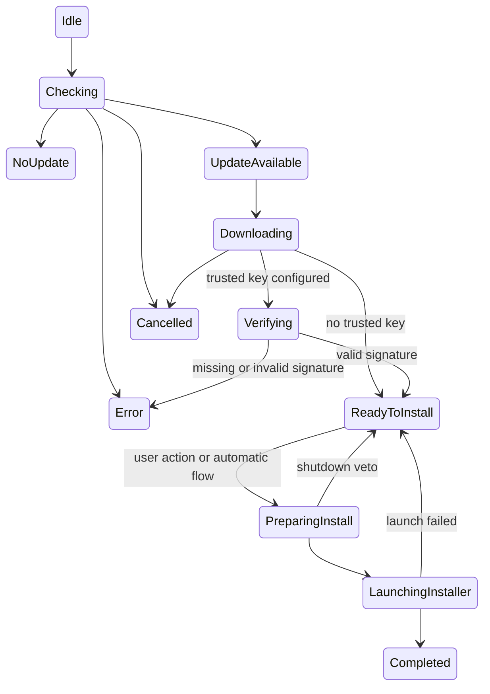

# Architecture

WinSparkle-NG implements the WinSparkle C API in a Rust DLL. The public ABI,
callback contract, settings, and intentional compatibility differences are
documented in [C API compatibility](api-compatibility.md). Build and test commands,
platform coverage, and translation credits are maintained in the [README](../README.md).

## Controller and update flow

The controller uses explicit `Phase` and `InstallFlow` types. Network workers
send messages through a Rust queue awakened by `PostMessageW`; only the updater
UI thread changes controls. Messages carry a generation number so a result that
arrives after cancellation cannot reopen the dialog or launch an installer.

Manual checks show progress and ignore skipped versions. Background checks
respect skipped versions and show the UI when an update is available. Periodic
checks use the saved permission and interval, with a minimum of one hour and a
default of one day. Appcast selection filters OS and architecture and compares
the build version separately from the display version.



The optional traditional flow waits for **Install now** after downloading.
The default one-click flow and automatic installation pass through
`ReadyToInstall` and launch during the same message-loop iteration. A shutdown
veto or launch failure retains the downloaded
file and its protected handle for a retry. The host's shutdown-request callback
runs only after successful installer launch or handling by its custom callback.

Cleanup cancels I/O, joins workers, closes the dialog, and releases handles and
incomplete downloads. Cleanup called from a UI callback starts shutdown without
joining its own thread; the host must return from the callback before unloading
the DLL. RAII covers cancellation and panic paths. Leftover removal accepts only
direct children of the system temporary directory with a `WinSparkle-NG-` prefix
and a 128-bit hexadecimal suffix, without following junctions.

## HTTP backend

WinHTTP provides networking, Schannel TLS, and Windows proxy integration without
an additional runtime or vendored HTTP library. The `spikes/http` crate compares
WinHTTP with static curl/Schannel using the same release profile. The initial
Windows x64 GET prototypes measured 200,704 and 812,544 DLL bytes respectively;
these are prototype sizes, not the size of the complete updater.

```powershell
cargo build -p http-spike --release --target x86_64-pc-windows-msvc --target-dir bw
cargo build -p http-spike --release --target x86_64-pc-windows-msvc --features curl-backend --target-dir bc
```

The production worker exposes a synchronous Rust interface over asynchronous
WinHTTP operations. It checks cancellation every 25 ms, closes requests on their
owner worker, and waits for `HANDLE_CLOSING` before releasing request context and
buffers. No Tokio runtime is needed.

DNS/connect timeouts are 10 seconds and send/read timeouts are 30 seconds. The
worker also limits each completion wait to 45 seconds and each transfer to
30 minutes. Redirects are bounded, HTTPS downgrade and embedded URL credentials
are rejected, and custom headers are stripped on cross-origin redirects.
Downloads stream to a temporary file; appcast parsing has a size limit.

Proxy selection uses `WINHTTP_ACCESS_TYPE_AUTOMATIC_PROXY`. Actual authenticated
enterprise proxy and PAC deployments still need environment-specific testing.
Release packaging audits dependencies and PE imports/exports and writes the
results and size metrics to `artifacts/`.

## Resources and localization

| Module | Name / ID | Type | Purpose |
|---|---|---|---|
| Host EXE | `FeedURL` | `APPCAST` | Feed URL when not configured through the API |
| Host EXE | `EdDSAPub` | `EDDSA` | Trusted Base64 Ed25519 public key |
| Host EXE | `DSAPub` | `DSAPEM` | Detects an unsupported DSA-only policy |
| Host EXE | VERSIONINFO | StringFileInfo | CompanyName, ProductName, ProductVersion |
| DLL | 101 | DIALOGEX | Unicode dialog, Segoe UI, common controls v6 |
| DLL | 102 | ICON | WinSparkle-NG multi-resolution icon, with its SVG source in `resources/` |
| DLL | 1 | RT_MANIFEST | `asInvoker` policy for linked test/example executables, preventing x86 installer detection |
| DLL | 2 | RT_MANIFEST | Thread-local common controls v6 activation context |
| DLL | 1 | VERSIONINFO | WinSparkle-NG product metadata |
| DLL | 1000–1037 | STRINGTABLE | UI strings in imported locales, US English, and neutral resources |

The DLL obtains its own `HMODULE` from the address of `platform::module` using
`GetModuleHandleExW(FROM_ADDRESS | UNCHANGED_REFCOUNT)`. Resources belong to the
DLL, and lookup continues to work if the DLL is renamed.

The loader validates UTF-16 string blocks and tries the full locale, base
language or standard regional variant, en-US, and finally neutral resources.
`set_lang` takes precedence over `set_langid`, followed by the thread's preferred
UI languages. The UI thread sets its language and DPI awareness independently
of the host process policy. Translation import generates committed resources
and an ignored coverage report at `artifacts/translation-report.md`.

A single dialog template receives translated strings at runtime. Layout measures
text and buttons with the system font, widens the window when needed, and uses
system colors in light/high-contrast mode and an explicit palette in dark mode.
RTL languages apply `WS_EX_LAYOUTRTL`; keyboard navigation uses
`IsDialogMessageW`. Actual high-contrast and multiple-monitor DPI configurations
remain to be visually validated.

## Window themes

`win_sparkle_set_theme` stores an auto/light/dark preference and queues live changes
to the UI thread. Auto reads `AppsUseLightTheme` from the user's Windows
personalization settings; a missing preference defaults to light. The dialog
re-evaluates the preference on `WM_SETTINGCHANGE`, `WM_THEMECHANGED`, and
`WM_SYSCOLORCHANGE`. Windows high contrast always selects system colors and native
control painting, including when dark is explicitly requested.

Dark buttons and progress bars retain their native controls, input, state, and
accessibility. A per-window subclass paints their surfaces; determinate progress
uses the existing 0–1000 range, while a separate timer paints indeterminate
progress. Subclasses and timers are removed when their controls are destroyed.
GDI brushes belong to the UI and are released after its windows are destroyed.

Title-bar requests use `DwmSetWindowAttribute`; unsupported attributes are ignored
on older Windows builds. The optional `DarkMode_Explorer` theme class is requested
only for the notes control's native scrollbar, with a native fallback. No private
theme function ordinals or process-wide theme settings are used.
